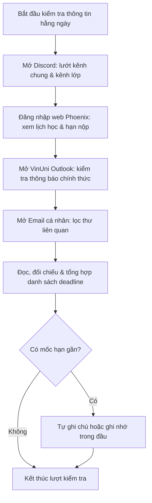
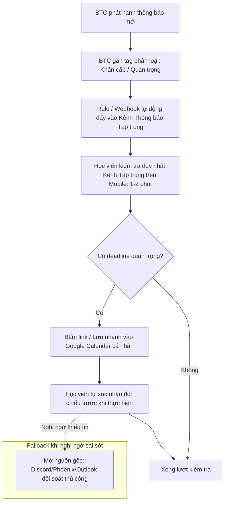

# Báo cáo nhóm — Day 02 Discovery & Problem Framing

> Bản chung của nhóm, viết trên repo do nhóm trưởng fork. Không copy file này sang repo cá nhân.
> Template chi tiết và prompt mẫu: [docs/01-worksheet.md](../../docs/01-worksheet.md). Bài mẫu: [docs/02-deliverable-example.md](../../docs/02-deliverable-example.md).

## 1. Thông tin nhóm

- Tên nhóm: NhomAI
- Thành viên: xem `TEAM.md` (Tăng Nguyễn Hải Đăng — 2A202603916, Nguyễn Đình Minh — 2A202603898)
- Candidate problem được chọn (1 câu): Học viên khó phát hiện kịp thời và theo dõi các thông báo quan trọng của chương trình VinUni AI Thực Chiến do thông tin phân tán trên nhiều nền tảng.
- Quyết định cuối: Go (thử nghiệm quy trình No AI / Rule) / Not Yet (xây dựng hệ thống phần mềm hoặc AI mới)

---

## 2. Hội tụ nhóm (CP3)

### 2.1. Pitch

| # | Người đưa ra | Candidate (Job Story ngắn) | Actor | Bottleneck | Câu hỏi phản biện nhận được (ai hỏi) |
|---:|---|---|---|---|---|
| 1 | Tăng Nguyễn Hải Đăng (D1) | Khi theo dõi các thông báo môn học và lịch trình tại VinUni, tôi muốn nắm bắt được toàn bộ thông báo quan trọng và deadline sắp tới (trong 1–2 ngày) tại một nơi tập trung, để không bỏ lỡ các mốc quan trọng (standup, chọn nhóm). | Học viên VinUni | Đọc, đối chiếu và tổng hợp deadline từ 4 kênh (khoảng 10–15 phút/lần). | • Q1: Vấn đề có thật sự tồn tại diện rộng hay chỉ là trải nghiệm cá nhân? (Đăng: Từng suýt lỡ Daily Standup và trễ hạn chọn nhóm; chưa có khảo sát diện rộng).<br>• Q2: Nguyên nhân từ hệ thống kênh hay do học viên chưa chủ động? (Đăng: Đến từ cả hai phía; kênh phân tán và học viên không ghi chép).<br>• Q3: Vì sao Calendar hoặc Discord Notifications chưa đủ? (Đăng: Thông báo điện thoại hay bị trôi hoặc chỉ có preview, Calendar không tự tổng hợp từ nhiều nguồn).<br>• Q4: Có nhất thiết cần AI hay cải thiện quy trình/rule là đủ? (Đăng: Ưu tiên tối ưu quy trình phân phối kênh trước, chưa nhất thiết cần AI).<br>• Q5: Đo lường hiệu quả thế nào? (Đăng: Đo thời gian kiểm tra và số lần trễ hạn).<br>• Q6: Gom tất cả vào một nền tảng có khả thi không? (Đăng: Phức tạp về API và bảo mật; nên ưu tiên quy trình trước).<br>• Q7: Vì sao chọn D1 thay vì M1? (Đăng: D1 thuận lợi tiếp cận học viên cùng khóa để kiểm chứng ngay trong lab; M1 vướng bảo mật dữ liệu doanh nghiệp). *(Phản biện do Đăng tự xác nhận trong thảo luận)* |
| 2 | Tăng Nguyễn Hải Đăng (D2) | Khi chuẩn bị hoàn thiện và nộp bài lab, tôi muốn có danh mục đối soát tập trung toàn bộ yêu cầu kỹ thuật đến quy định nộp, để không bị thiếu sót tiêu chí hoặc nhầm lẫn giữa push Git và nộp LMS. | Học viên khóa AI Thực Chiến | Đọc và đối soát chéo giữa nhiều tài liệu (khoảng 20–30 phút). | Một bảng checklist cố định hoặc script kiểm tra repo có thể đã giải quyết được 80% vấn đề mà không cần đến giải pháp phức tạp hơn? (Thảo luận nhóm) |
| 3 | Tăng Nguyễn Hải Đăng (D3) | Khi tiếp nhận một dự án phần mềm có sẵn (legacy codebase) với nhiều repo và microservices, tôi muốn hiểu nhanh kiến trúc hệ thống và cách thiết lập môi trường chạy thử cục bộ, để bắt đầu đóng góp code an toàn. | Kỹ sư phần mềm mới nhận dự án | Gỡ lỗi cấu hình môi trường và chờ giải đáp từ đồng nghiệp (Chưa đo). | Bài toán có phạm vi quá rộng so với thời lượng một buổi lab không, và nhóm đã có số liệu đo lường cụ thể chưa? (Thảo luận nhóm) |
| 4 | Nguyễn Đình Minh (M1) | Khi chuẩn bị kiểm thử phần mềm, tôi muốn đối chiếu nhanh các pattern, viewpoint và checklist testcase với yêu cầu nghiệp vụ, để không bỏ sót các trường hợp kiểm thử quan trọng. | Kỹ sư kiểm thử (Tester/QA) | Đối chiếu thủ công giữa tài liệu yêu cầu và checklist testcase. | Dữ liệu dự án thực tế có vướng bảo mật khách hàng/doanh nghiệp không, và có tiếp cận được tập người dùng đủ lớn để phỏng vấn kiểm chứng trong lab không? (Thảo luận nhóm) |
| 5 | Nguyễn Đình Minh (M2) | Khi hoàn thành kịch bản kiểm thử, tôi muốn cập nhật nhanh kết quả testcase vào file Excel theo mẫu chuẩn dự án, để giảm thời gian nhập liệu thủ công lặp lại. | Kỹ sư kiểm thử (Tester/QA) | Nhập và định dạng kết quả test từng dòng vào Excel thủ công. | Dữ liệu dạng bảng có cấu trúc cao này có thể giải quyết hoàn toàn bằng script/macro Excel mà không cần mức can thiệp cao hơn? (Thảo luận nhóm) |
| 6 | Nguyễn Đình Minh (M3) | Khi ghi nhận lỗi hoặc trao đổi trong ticket/testcase, tôi muốn tạo log và comment đúng mẫu chuẩn ngay lần đầu, để tránh bị nhắc nhở hoặc phải sửa lại định dạng. | Kỹ sư kiểm thử / Lập trình viên | Viết và chỉnh sửa định dạng comment/log theo quy chuẩn dự án. | Việc chuẩn hóa định dạng văn bản này có thể xử lý phần lớn bằng form mẫu (template) hoặc linter/rule kiểm tra định dạng không? (Thảo luận nhóm) |

### 2.2. Cluster

| Cluster | Các candidate | Pattern chung |
|---|---|---|
| A | D1, D2 | **Phân tán thông tin và đối soát quy định:** Thông tin phân mảnh trên nhiều kênh/tài liệu rời rạc, người học mất thời gian tra cứu và đối chiếu thủ công để tránh rủi ro trễ hạn hoặc sai quy cách. |
| B | D3, M1 | **Nắm bắt kiến thức và đối chiếu kỹ thuật:** Người thực hiện gặp khó khăn khi đối chiếu giữa tài liệu nghiệp vụ/yêu cầu với hệ thống thực tế (mã nguồn legacy hoặc checklist testcase), phụ thuộc nhiều vào kiến thức nền tảng và người đi trước. |
| C | M2, M3 | **Thao tác thủ công và chuẩn hóa định dạng:** Công việc mang tính hành chính/thao tác lặp lại (nhập kết quả Excel, format comment/log), dễ sai sót định dạng và có thể chuẩn hóa bằng quy tắc/form mẫu cố định. |

### 2.3. Opportunity Solution Tree rút gọn

Gốc là **1 outcome**. Nhánh là **opportunity** (nhu cầu, pain), không phải tính năng hay công cụ.

```text
OUTCOME: Học viên giảm nguy cơ bỏ lỡ thông báo và deadline quan trọng của chương trình VinUni AI Thực Chiến
├── Opportunity A: Thông tin phân tán trên nhiều nền tảng (Discord, Phoenix, Outlook, Email cá nhân)
├── Opportunity B: Một số nguồn khó theo dõi và thao tác thuận tiện bằng điện thoại (Phoenix, thời khóa biểu HTML)
├── Opportunity C: Khó phân biệt thông báo quan trọng/khẩn cấp với các trao đổi thảo luận thông thường trong kênh chat
├── Opportunity D: Chưa có cơ chế ghi nhớ và theo dõi deadline nhất quán giữa các tuần học
└── Opportunity E: Thông báo trên thiết bị di động có thể bị trôi, ẩn hoặc không hiển thị đầy đủ nội dung chi tiết
```

Những ý đã gạch bỏ vì là solution đội lốt opportunity:

- ✗ "Xây dựng AI Agent hoặc chatbot tự động đọc và tóm tắt thông báo" (Solution đội lốt opportunity)
- ✗ "Tích hợp tất cả các nguồn vào một ứng dụng/dashboard tập trung" (Solution đội lốt opportunity)
- ✗ "Cải thiện quy trình gửi thông báo từ Ban tổ chức / gắn tag @everyone" (Solution can thiệp quy trình)
- ✗ "Dùng Google Calendar để đồng bộ tất cả lịch học" (Solution dùng công cụ có sẵn)

### 2.4. Chấm điểm shortlist (1–5)

| Candidate | Actor rõ | Quy trình rõ | Pain có bằng chứng | Impact đo được | Vừa sức lab | So sánh được No AI/Rule/Workflow/Agent | Nhóm hiểu domain | Tổng |
|---|---:|---:|---:|---:|---:|---:|---:|---:|
| D1 (Phân tán thông tin VinUni) | 5 | 5 | 4 | 4 | 5 | 5 | 5 | 33 |
| D2 (Đối chiếu quy định bài Lab) | 5 | 5 | 4 | 5 | 5 | 3 | 5 | 32 |
| D3 (Tiếp nhận legacy codebase) | 5 | 4 | 3 | 2 | 2 | 4 | 4 | 24 |
| M1 (Đối chiếu pattern testcase) | 5 | 5 | 5 | 4 | 2 | 4 | 3 | 28 |
| M2 (Nhập kết quả test vào Excel) | 5 | 5 | 5 | 5 | 3 | 2 | 3 | 28 |
| M3 (Log/comment testcase sai mẫu) | 5 | 5 | 4 | 4 | 3 | 2 | 3 | 26 |

*Ghi chú:* Đây là bảng điểm đánh giá đề xuất của nhóm dựa trên phân tích bằng chứng sẵn có để cùng thảo luận, chưa được ghi nhận thành kết quả bỏ phiếu chấm độc lập của từng thành viên.

*Căn cứ định tính cho từng ứng viên (chờ hai thành viên chốt điểm số chính thức):*
- **D1:** Actor rõ (học viên VinUni), quy trình 5 bước rõ ràng, có bằng chứng thực tế (suýt lỡ standup, trễ hạn chọn nhóm), đo được thời gian (10–20 phút/lần), rất vừa sức lab vì người dùng mục tiêu chính là các bạn học cùng khóa, dễ so sánh từ Rule (lọc email/webhook) đến Workflow/AI.
- **D2:** Actor và quy trình rõ (đối soát bài lab), đo được thời gian (30–60 phút), nhưng phạm vi hẹp và hoàn toàn có thể giải quyết bằng checklist cố định (Rule), khó mở rộng phân tích các mức can thiệp cao hơn.
- **D3:** Nỗi đau kỹ thuật có thật nhưng phạm vi rất rộng, chưa có số liệu đo lường cụ thể (ghi nhận "Chưa đo") và khó kiểm chứng trong thời lượng buổi lab.
- **M1:** Điểm nghẽn kỹ thuật rõ, nghiệp vụ tốt; tuy nhiên phụ thuộc vào dữ liệu dự án doanh nghiệp và ràng buộc bảo mật khách hàng, khó phỏng vấn người dùng rộng rãi tại lớp.
- **M2:** Quy trình nhập liệu Excel rõ ràng nhưng bài toán mang tính thuần Rule/Macro tự động hóa bảng tính, giải pháp đơn giản đã giải quyết triệt để.
- **M3:** Lỗi định dạng comment/log mang tính thao tác, form mẫu hoặc linter đã xử lý phần lớn vấn đề.

**Candidate được chọn:**
D1 — Học viên khó phát hiện kịp thời và theo dõi các thông báo quan trọng của chương trình VinUni AI Thực Chiến do thông tin phân tán trên nhiều nền tảng.

**Vì sao chọn:**
1. **Có trải nghiệm trực tiếp và hậu quả thực tế:** Tác giả (Đăng) từng suýt lỡ Daily Standup và đã bỏ lỡ hạn chọn nhóm dẫn đến bị hệ thống xếp nhóm ngẫu nhiên.
2. **Kênh thông tin phân tán có thật:** Thông báo xuất hiện rải rác trên Discord, Phoenix, Outlook, Email cá nhân.
3. **Rào cản thiết bị thực tế:** Học viên không phải lúc nào cũng mang theo hoặc mở laptop để kiểm tra thông tin.
4. **Trải nghiệm di động chưa tối ưu:** Một số nền tảng (như Phoenix hoặc thời khóa biểu dạng HTML) chưa thuận tiện khi thao tác trên điện thoại.
5. **Thuận lợi kiểm chứng người dùng:** Có thể tiếp cận trực tiếp các học viên cùng khóa VinUni để phỏng vấn, khảo sát và kiểm chứng giả định ngay trong buổi lab.
6. **Phạm vi vừa sức, mục tiêu cụ thể:** Giới hạn rõ ràng ở các thông báo quan trọng và deadline gần (trong 1–2 ngày tới).
7. **Không gian phân tích mức can thiệp đa dạng:** Có thể giải quyết bằng quy trình hoặc công cụ có sẵn (No AI / Rule / Workflow), không nhất thiết phải dùng AI phức tạp.

**Vì sao loại các candidate còn lại:**
- **D2 (Đối chiếu quy định bài Lab):** Bài toán hẹp, có khả năng giải quyết tốt bằng bảng checklist cố định hoặc script kiểm tra đơn giản, chưa đủ độ phức tạp để phân tích các mức can thiệp.
- **D3 (Tiếp nhận legacy codebase phức tạp):** Phạm vi quá rộng, thiếu số liệu đo lường định lượng và khó thực hiện kiểm chứng thực nghiệm trong thời lượng một buổi lab.
- **M1 (Đối chiếu pattern/viewpoint testcase):** Bài toán nghiệp vụ tốt, có điểm nghẽn kỹ thuật rõ; tuy nhiên việc kiểm chứng phụ thuộc vào dữ liệu dự án doanh nghiệp và rào cản bảo mật khách hàng, khó phỏng vấn người dùng rộng rãi trong lab.
- **M2 (Nhập kết quả testcase vào Excel):** Dữ liệu có cấu trúc cao, hoàn toàn có thể giải quyết bằng script/macro tự động hóa bảng tính mà không cần tới giải pháp phức tạp hơn.
- **M3 (Log/comment testcase sai mẫu):** Bài toán định dạng văn bản có thể xử lý phần lớn bằng form mẫu (template) hoặc công cụ linter/rule kiểm tra định dạng.

**Xử lý bất đồng (nếu có):**
Nhóm lựa chọn D1 vì có bằng chứng trải nghiệm trực tiếp và thuận lợi để tiếp tục kiểm chứng với học viên. Bảng điểm ở Mục 2.4 là đánh giá đề xuất; trao đổi và phản biện cá nhân chỉ ghi nhận khi thành viên xác nhận.

**Các câu hỏi / giả định cốt lõi cần kiểm chứng ở CP4:**
- Có bao nhiêu học viên thực sự gặp vấn đề tương tự?
- Những nguồn thông tin nào thường bị bỏ sót nhất (Discord, Phoenix, Email trường hay Email cá nhân)?
- Nguyên nhân chính là do phân tán kênh, thiếu nhắc lại, khó khăn trên thiết bị di động hay thói quen cá nhân?
- Phương án No AI (cải thiện quy trình thông báo, checklist, forwarding) có đủ giải quyết pain hay không?
- Ban tổ chức chương trình có thể thay đổi quy trình gửi thông báo hay không?

---

## 3. Kiểm chứng + research giải pháp đã có (CP4)

### 3.1. Assumption Map

| # | Giả định | Loại (Value / Usability / Feasibility / Viability) | Quan trọng (1–5) | Đã có bằng chứng (1–5) | Kiểm chứng trước? |
|---:|---|---|---:|---:|---|
| 1 | Đa số học viên cùng khóa cũng gặp khó khăn khi theo dõi thông báo và deadline do thông tin phân tán trên nhiều nền tảng | Value | 5 | 2 | Cần kiểm chứng thực tế |
| 2 | Các thông báo quan trọng nhất (standup, chọn nhóm, nộp bài) thường bị bỏ lỡ hoặc phát hiện muộn do thông báo trên điện thoại bị trôi hoặc chỉ hiển thị preview | Usability | 4 | 2 | Cần kiểm chứng thực tế |
| 3 | Học viên mong muốn có một điểm chạm tập trung (như bot thông báo hoặc checklist định kỳ) nhắc việc trước 1–2 ngày | Value | 4 | 1 | Cần kiểm chứng thực tế |
| 4 | Có thể trích xuất hoặc nhận webhook thông báo từ Discord, Outlook, Phoenix mà không vi phạm chính sách bảo mật hay quyền riêng tư | Feasibility | 4 | 2 | Có (nghiên cứu kỹ thuật) |
| 5 | Giải pháp thuần quy trình (Ban tổ chức gắn tag/tập trung 1 kênh) hoặc công cụ có sẵn (Calendar/Rule) có thể giải quyết được phần lớn vấn đề mà chưa cần AI phức tạp | Viability | 5 | 2 | Có (đối chiếu giải pháp) |

Giả định nhóm kiểm chứng trong buổi này:
- **Giả định #1 (Nhu cầu thực tế của học viên — Value):** Xác thực xem nỗi đau phân tán thông báo có phổ biến ở các học viên khác hay chỉ là cá biệt.
- **Giả định #2 (Điểm nghẽn kênh & trải nghiệm di động — Usability):** Làm rõ việc theo dõi thông tin trên điện thoại có thực sự là rào cản chính hay không.
- **Giả định #5 (Tính khả thi của phương án No AI / Rule — Viability):** Đánh giá liệu việc chuẩn hóa quy trình thông báo và dùng công cụ sẵn có đã đủ giải quyết vấn đề hay chưa.

### 3.2. Kiểm chứng

**Cách thực hiện:** Đối chiếu trải nghiệm thực tế đã ghi nhận của Đăng, phân tích 3 kịch bản tình huống hành vi giả định và nghiên cứu 4 giải pháp hiện có.

**Hạn chế kiểm chứng:** Do giới hạn thời gian trong buổi lab, nhóm **chưa thực hiện phỏng vấn độc lập** với các học viên khác. Nguồn bằng chứng thực tế duy nhất hiện có là trải nghiệm thật của Đăng (suýt lỡ Daily Standup, trễ hạn chọn nhóm thật, thời gian rà soát 10–20 phút/lượt) kết hợp với Assumption Map và kết quả research. Ba trường hợp A, B, C dưới đây là các tình huống giả định nhằm phục vụ phân tích quy trình và bóc tách điểm nghẽn, **không trình bày là kết quả phỏng vấn thật hay số liệu khảo sát người thật**.

**Kế hoạch phỏng vấn bổ sung:** Nhóm đã chuẩn bị sẵn bộ câu hỏi The Mom Test gồm 5 câu hỏi dưới đây để triển khai phỏng vấn bổ sung 3–5 học viên trong giai đoạn thử nghiệm pilot 1 tuần sắp tới nhằm hoàn thiện dữ liệu thực chứng cho CP4.

**Kịch bản câu hỏi The Mom Test (hỏi về hành vi quá khứ, không hỏi ý kiến tương lai):**
1. *"Trong tuần học vừa rồi, bạn thường theo dõi các thông báo của lớp VinUni qua những kênh nào?"*
2. *"Lần gần nhất bạn suýt bị muộn hoặc bỏ lỡ một thông báo/deadline quan trọng là khi nào? Chuyện gì đã xảy ra lúc đó?"*
3. *"Khi nhận được thông báo quan trọng (ví dụ chọn nhóm, deadline bài tập), hiện tại bạn đang lưu lại hoặc theo dõi bằng cách nào (workaround)?"*
4. *"Bước nào trong việc kiểm tra thông báo khiến bạn cảm thấy mất thời gian hoặc dễ sót nhất? Mất khoảng bao nhiêu phút?"*
5. *"Bạn đã từng thử dùng công cụ hay cách làm nào (như lịch cá nhân, bookmark, ghi chú) để giải quyết chưa? Hiệu quả ra sao?"*

*(Lưu ý phương pháp: Nhóm sử dụng 3 trường hợp điển hình dưới đây làm dữ liệu kịch bản hành vi để phân tích cơ chế điểm nghẽn và định hình hướng kiểm chứng thực địa, không trình bày như kết quả khảo sát diện rộng đã hoàn tất).*

#### Trường hợp phân tích A — Học viên dùng điện thoại là thiết bị chính

| Trường | Nội dung |
|---|---|
| Người được phân tích (vai trò kịch bản) | Học viên thường xuyên di chuyển, chủ yếu dùng smartphone |
| Tình huống hành vi điển hình | Mở Discord đọc lướt thông báo trên đường đi học/làm; thấy nhắc có thông báo trên Phoenix nhưng không thể đăng nhập kiểm tra vì giao diện web Phoenix trên mobile khó thao tác. |
| Workaround hiện tại | Chụp màn hình (screenshot) tin nhắn Discord hoặc tự dặn về nhà mở laptop kiểm tra lại. |
| Thời gian / tần suất | Mất khoảng 10–15 phút/lượt khi phải mở laptop rà soát lại; 2–3 lần/tuần quên rà soát dẫn đến sát giờ mới biết deadline. |
| Insight / opportunity rút ra | Nhu cầu tiếp cận thông báo quan trọng dạng tóm tắt ngắn gọn ngay trên giao diện mobile mà không bắt buộc phải mở các trang web phức tạp. |

#### Trường hợp phân tích B — Học viên theo dõi nhiều kênh nhưng không lưu vết

| Trường | Nội dung |
|---|---|
| Người được phân tích (vai trò kịch bản) | Học viên tham gia đầy đủ các kênh (Discord, Outlook, Zalo/Telegram nhóm) |
| Tình huống hành vi điển hình | Đọc thông báo ngay khi có thông báo đẩy, nhưng đọc xong không ghi chú vào đâu; đến ngày cần nộp bài phải lội ngược hàng trăm tin nhắn thảo luận trong Discord để tìm link nộp hoặc tiêu chí. |
| Workaround hiện tại | Dùng tính năng ghim tin nhắn (pin) hoặc tự gửi tin nhắn vào mục "Saved Messages" cá nhân. |
| Thời gian / tần suất | Rà soát nhanh mất 5–10 phút/lượt, nhưng mỗi lần tìm lại thông tin cũ mất từ 15–20 phút lục lọi tin nhắn. |
| Insight / opportunity rút ra | Khó khăn không nằm ở việc nhận thông báo, mà nằm ở khâu trích xuất hạn chót (deadline) và phân loại thông báo quan trọng tách khỏi luồng thảo luận thông thường. |

#### Trường hợp phân tích C — Học viên có thói quen dùng Calendar hiệu quả (Kịch bản đối lập)

| Trường | Nội dung |
|---|---|
| Người được phân tích (vai trò kịch bản) | Học viên có kỹ năng quản lý thời gian cá nhân tốt |
| Tình huống hành vi điển hình | Mỗi đầu tuần, dành 15 phút rà soát toàn bộ lịch học và bài tập, tự nhập tay toàn bộ sự kiện vào Google Calendar cá nhân có cài đặt nhắc trước 1 ngày và 2 giờ. |
| Workaround hiện tại | Nhập lịch thủ công vào Google Calendar ngay khi nhận được thông báo đầu tiên. |
| Thời gian / tần suất | Tốn khoảng 15 phút cố định vào sáng thứ Hai; trong tuần hầu như không mất thời gian tìm kiếm lại và không bị trễ hạn. |
| Insight / opportunity rút ra | **Giả thuyết đối lập:** Thói quen ghi chép và Google Calendar có thể giúp giảm khó khăn mà không cần thêm hệ thống mới, đặt ra nghi vấn liệu có thực sự cần thiết phải xây dựng hệ thống phần mềm hay AI phức tạp hay không. |

Tổng hợp phân tích dữ liệu:

| Nguồn | Số trường hợp | Bằng chứng ủng hộ | Giả thuyết phản bác cần kiểm chứng |
|---|---:|---|---|
| Trải nghiệm thực tế của Đăng & phân tích kịch bản nhóm | 1 trải nghiệm cá nhân + 3 kịch bản giả định (không tính là 3 mẫu khảo sát) | • Rà soát nhiều kênh tốn 10–20 phút/lần.<br>• Từng bị lỡ hạn chọn nhóm thật.<br>• Giao diện web phức tạp trên mobile gây cản trở truy cập. | • Kịch bản C minh họa khả năng Calendar hỗ trợ quản lý lịch tốt; chưa có dữ liệu thực tế để khẳng định không trễ deadline.<br>• Khả năng nguyên nhân đến từ thói quen quản lý lịch cũng cần kiểm chứng, không thể kết luận chỉ do hệ thống. |

**Điều chỉnh phạm vi sau phân tích vấn đề và nghiên cứu giải pháp:**
1. **Thu hẹp phạm vi bài toán:** Không cố gắng gom tất cả mọi tin nhắn hay thảo luận của lớp; chỉ tập trung vào **các mốc sự kiện có deadline bắt buộc** (standup, hạn chọn nhóm, hạn nộp bài lab).
2. **Ưu tiên giải pháp đơn giản trước:** Thay vì hướng tới việc xây dựng bot AI hay nền tảng tích hợp cồng kềnh, nhóm định hướng giải pháp vào việc **chuẩn hóa quy trình thông báo và tận dụng các công cụ quản lý lịch sẵn có (No AI / Rule)**.

### 3.3. Research giải pháp đã có

| Công cụ / case / pattern | Link nguồn chính thức | Giải bước nào trong quy trình? | Điểm mạnh | Khoảng trống / rủi ro | Bài học cho nhóm |
|---|---|---|---|---|---|
| **Google Calendar / Notion Calendar** | https://calendar.google.com | Quản lý mốc thời gian, nhắc nhở deadline tự động trước sự kiện. | Giao diện quen thuộc, hỗ trợ thông báo đẩy trên mobile rất tốt, hoàn toàn miễn phí. | Không tự động đọc hiểu và trích xuất nội dung từ văn bản thông báo thô (Discord/Email); phụ thuộc 100% vào việc người dùng tự nhập tay. | Giải pháp No AI nền tảng đã làm rất tốt việc nhắc hẹn; nếu giải quyết được khâu nhập liệu tự động thì không cần làm thêm app mới. |
| **Discord Webhook + Channel Thông báo** | https://discord.com/developers/docs/resources/webhook | Nhận thông báo từ hệ thống có khả năng gửi HTTP POST vào kênh Discord; nguồn không hỗ trợ cần bước chuyển tiếp hoặc thao tác thủ công. | Có thể triển khai đơn giản nếu có quyền cấu hình và nguồn gửi phù hợp, học viên sẵn có ứng dụng trên điện thoại. | Vẫn có thể bị trôi tin nhắn nếu tần suất gửi cao; không có tính năng đặt lịch hẹn tự động vào calendar cá nhân. | Có thể dùng làm bước chuyển tiếp dữ liệu dạng Rule đơn giản để tập trung thông tin về một mối. |
| **Email Forwarding + Outlook Rules** | https://support.microsoft.com/en-us/office/use-rules-to-manage-your-email-c24f5dea-9465-4df4-ad17-a50704d66c59 | Tự động phân loại, lọc và chuyển tiếp email của trường theo từ khóa. | Chạy ngầm ổn định, lọc được email rác, tận dụng hệ sinh thái Outlook sẵn có của VinUni. | Chỉ giới hạn trong phạm vi hòm thư email; không xử lý được thông báo trên Discord hay cổng thông tin Phoenix. | Rule cố định giải quyết tốt luồng email nhưng không thể xử lý đa kênh. |
| **Quy trình chuẩn hóa thông báo BTC** | https://pair.withgoogle.com/chapter/user-needs/ | Phân loại thông báo ngay từ gốc (Khẩn cấp / Quan trọng / Bản tin). | Hạn chế đáng kể vấn đề từ nguồn phát mà không cần can thiệp kỹ thuật hay phần mềm. | Phụ thuộc hoàn toàn vào tính kỷ luật của người gửi thông báo; học viên không thể chủ động can thiệp. | Cải tiến quy trình là bước đi đầu tiên cần khuyến nghị trước khi đầu tư giải pháp công nghệ. |

---

## 4. Quy trình trước/sau (CP5)

### 4.1. Quy trình hiện tại

Sơ đồ quy trình hiện tại:



Bảng mô tả các bước trong quy trình hiện tại:

| Bước | Actor | Input | Output | Thời gian / tần suất | Ghi chú |
|---:|---|---|---|---|---|
| 1 | Học viên | Ứng dụng Discord | Đọc các tin nhắn mới trong ngày | 3–5 phút / 2–3 lần/ngày | Dễ bị xao nhãng bởi các luồng thảo luận bài vở |
| 2 | Học viên | Cổng web Phoenix | Lịch học và bài tập được giao | 3–5 phút / 1 lần/ngày | Giao diện trên điện thoại khó thao tác, hay phải zoom |
| 3 | Học viên | VinUni Outlook | Danh sách email từ giảng viên/trường | 2–3 phút / 1–2 lần/ngày | Kiểm tra thông báo hành chính chính thức |
| 4 | Học viên | Hòm thư cá nhân | Email cập nhật lịch, thông báo bổ sung | 2 phút / 1 lần/ngày | Rà soát các thông tin dự phòng |
| 5 | Học viên | Nội dung thô từ 4 nguồn trên | Danh sách các việc cần làm và hạn chót | 5–7 phút / lần | **BOTTLENECK CHÍNH:** Phải tự đọc hiểu, lọc bỏ thông tin phụ và đối chiếu ngày giờ |
| 6 | Học viên | Danh sách hạn chót đã lọc | Ghi chú trong đầu / Note điện thoại | 1 phút / lần | Dễ quên nếu không ghi chép cẩn thận |

**Bottleneck chính:** Bước 5 — Đọc, đối chiếu và tổng hợp thông tin từ nhiều nguồn phân tán. Học viên phải tự phân loại thông tin nào là khẩn cấp, thông tin nào chỉ là thông báo chung, dẫn đến tốn tổng cộng **10–20 phút/lượt rà soát** và nguy cơ bỏ sót cao.

### 4.2. Quy trình tương lai

Quy trình tương lai định hướng **No AI / Rule-based**: Chuẩn hóa kênh phát thông tin kết hợp cơ chế đồng bộ lịch có sẵn.



Phân định trách nhiệm và ranh giới trong quy trình tương lai:
- **Bước phía Ban tổ chức (Con người):** Đánh giá mức độ quan trọng ngay khi soạn thảo, gắn thẻ chuẩn cú pháp (`[URGENT]`, `[DEADLINE]`) trước khi gửi.
- **Bước Rule / Webhook (Tự động hóa không dùng AI):** Tự động chuyển tiếp các tin nhắn có gắn thẻ ưu tiên về một kênh thông báo duy nhất hoặc tự động tạo sự kiện lịch thông qua định dạng chuẩn.
- **Bước Học viên (Con người - Human-in-the-loop):** Đọc nội dung tóm tắt trên kênh tập trung, trực tiếp xác nhận và bấm thêm vào lịch cá nhân; học viên giữ quyền quyết định cuối cùng trong việc thực hiện công việc.
- **Ranh giới (Boundary):** Hệ thống tự động **KHÔNG** tự ý thay mặt học viên nộp bài, không tự ý xóa hay bỏ qua thông báo nếu không có quy tắc rõ ràng, và không tự thay đổi thời hạn hiển thị.
- **Phương án quay về (Fallback):** Nếu nghi ngờ hệ thống phân loại bỏ sót hoặc kênh tập trung gặp lỗi kỹ thuật, học viên chủ động mở trực tiếp nguồn gốc chính thức (Phoenix/Outlook/Discord) để kiểm tra đối soát thủ công theo quy trình cũ.

### 4.3. Before / after

| Chỉ số | Trước (Baseline có bằng chứng) | Sau (Target kỳ vọng) | Ghi chú so sánh |
|---|---:|---:|---|
| **Số bước thực hiện** | 6 bước do học viên thực hiện | 3 thao tác chính phía học viên (mở kênh, đọc, lưu/xác nhận) | Quy trình tương lai còn có các bước của BTC và Rule; không so sánh tổng số bước toàn hệ thống |
| **Tổng thời gian rà soát** | 10–20 phút / lượt rà soát (baseline thực tế) | Dưới 3 phút / lượt rà soát (target kỳ vọng) | Giảm ít nhất 70% thời gian kiểm tra thông báo mỗi lượt |
| **Số bước thủ công** | 6 bước của học viên | Khoảng 2–3 thao tác thủ công (đọc, lưu lịch, xác nhận) | Tự động hóa khâu gom luồng thông báo bằng Rule |
| **Điểm nghẽn chính** | Đọc hiểu và đối chiếu chéo nhiều nguồn | Xác nhận đối chiếu nhanh thông tin | Chuyển điểm nghẽn từ tìm kiếm sang kiểm tra |
| **Rủi ro mới phát sinh** | Bỏ sót do quá tải thông tin nhiều kênh | Lệ thuộc vào kênh tập trung; rule lọc sai từ khóa | Khắc phục bằng quy tắc gắn tag chặt chẽ và cơ chế fallback |

---

## 5. Problem Statement v0 (CP5)

| Trường | Nội dung |
|---|---|
| **Actor** | Học viên tham gia chương trình VinUni AI Thực Chiến K5-L3B. |
| **Quy trình** | Hằng ngày kiểm tra phân tán qua Discord, Phoenix, Outlook và email cá nhân để tìm kiếm thông báo và thời hạn nộp bài. |
| **Bottleneck** | Phải đối chiếu thủ công giữa nhiều kênh thông tin rời rạc không đồng bộ, mất 10–20 phút/lượt và dễ bị trôi tin nhắn trên thiết bị di động. |
| **Impact** | Nguy cơ bỏ sót các mốc quan trọng (suýt lỡ Daily Standup, trễ hạn chọn đề tài/nhóm dẫn đến bị xếp nhóm ngẫu nhiên, nguy cơ trễ hạn nộp lab). |
| **Success Metric** | • Giảm thời gian kiểm tra thông báo từ **10–20 phút/lượt (baseline)** xuống **dưới 3 phút/lượt (target)**.<br>• Giữ tỷ lệ bỏ sót deadline quan trọng ở mức **0 sự cố/khóa học**.<br>• Cách đo: Học viên tự ghi nhận nhật ký thời gian kiểm tra và lịch sử tham gia các mốc bắt buộc trong 1 tuần pilot. |
| **Boundary** | Giải pháp tự động chỉ hỗ trợ tập hợp và chuyển tiếp thông tin; **KHÔNG** tự ý quyết định thay cho học viên; học viên bắt buộc phải tự xác nhận đối chiếu với nguồn gốc trước các mốc hạn quan trọng (Human-in-the-loop). |

**Phản biện nhận được đối với Problem Statement v0:**
- *Ý kiến phản biện:* Bài toán mô tả việc tốn thời gian gom thông tin, nhưng thực chất nếu Ban tổ chức chỉ gửi thông báo trên đúng 1 kênh Discord duy nhất thì vấn đề có tự biến mất không?
- *Phản hồi của nhóm:* Đồng ý một phần. Việc phân tán kênh là thực tế khách quan của trường đại học (hệ thống đào tạo Phoenix, email hành chính Outlook, kênh trao đổi Discord). Tuy nhiên, điều này càng củng cố quan điểm của nhóm: **Vấn đề cốt lõi có thể giải quyết bằng cải tiến quy trình phân phối (No AI)** trước khi nghĩ tới việc xây dựng phần mềm AI.

---

## 6. Mức can thiệp AI (CP6)

### 6.1. Ma trận độ mơ hồ × độ phức tạp

Bài của nhóm nằm ở ô: **Độ mơ hồ thấp × Độ phức tạp thấp đến trung bình**.

Vì sao:
- **Độ mơ hồ thấp (Low Ambiguity):** Tiêu chí đánh giá một thông báo có phải là deadline hay không rất rõ ràng (có ngày, có giờ cụ thể, có yêu cầu hành động rõ ràng). Đầu ra mong đợi là thông tin chính xác cao (đúng ngày, đúng giờ, đúng nội dung hạn nộp), không đòi hỏi sự sáng tạo hay suy diễn ngữ nghĩa phức tạp.
- **Độ phức tạp thấp đến trung bình (Low-to-Medium Complexity):** Nguồn dữ liệu chỉ bao gồm văn bản thông báo từ 3–4 kênh cố định, quy trình xử lý tuyến tính (nhận tin $\to$ lọc từ khóa/thẻ $\to$ chuyển tiếp $\to$ nhắc lịch), không có nhiều nhánh rẽ phụ thuộc phức tạp.

Theo framework của Anthropic và tài liệu hướng dẫn Lab: Ô này phù hợp tối ưu với giải pháp **No AI** hoặc **Rule-based Automation**.

### 6.2. So sánh 4 mức

| Mức | Phương án cụ thể cho bài toán | Đủ khi nào | Rủi ro | Chọn? |
|---|---|---|---|:---:|
| **No AI** (Chuẩn hóa quy trình) | Ban tổ chức quy định rõ kênh thông báo chính; gắn tag cố định (`[DEADLINE]`); học viên tự dùng Google Calendar nhập lịch. | Đủ khi các bên tuân thủ kỷ luật truyền thông và học viên duy trì thói quen ghi chép. | Con người quên gắn tag; học viên lười nhập lịch thủ công. | **Ưu tiên thử nghiệm đầu tiên** |
| **Rule** (Tự động hóa có điều kiện) | Dùng Webhook Discord / Outlook Rules lọc email có từ khóa `deadline`, `standup` để đẩy về 1 channel Telegram/Discord duy nhất. | Đủ khi định dạng thông báo có cấu trúc từ khóa nhất quán. | Bỏ sót nếu thông báo dùng từ đồng nghĩa; đẩy nhầm nếu từ khóa xuất hiện trong tin nhắn tán gẫu. | **Khuyến nghị kết hợp** |
| **Workflow (kèm AI nhẹ)** | Code định sẵn quy trình lấy tin nhắn; gọi LLM trích xuất ngày, giờ, việc cần làm từ văn bản tự do rồi tạo file lịch `.ics`. | Đủ khi văn bản thông báo viết tự do, dài dòng, không theo cấu trúc cố định nào. | Tốn chi phí API token; độ trễ xử lý; nguy cơ AI trích xuất sai ngày/giờ (hallucination). | Chưa cần thiết ở giai đoạn này |
| **Agent** (AI tự trị) | AI tự quyết định đọc kênh nào, tự tương tác hỏi lại giảng viên, tự động đăng ký nộp bài hoặc quyết định lịch học. | Chỉ cần khi hệ thống cần tự ra quyết định động và tương tác đa bước không xác định trước. | Rủi ro bảo mật cực cao; chi phí vận hành lớn; hành vi khó kiểm soát; vi phạm nghiêm trọng boundary an toàn. | **LOẠI BỎ HOÀN TOÀN** |

**Mức chọn:** **No AI kết hợp Rule đơn giản** (Quy chuẩn hóa cách gửi thông báo từ gốc + Webhook/Filter lọc từ khóa cố định).

**Vì sao không chọn mức phức tạp hơn (Workflow / Agent):**
- Bài toán không có độ mơ hồ cao. Việc trích xuất thông tin lịch trình hoàn toàn có thể giải quyết nếu Ban tổ chức chuẩn hóa cú pháp thông báo.
- Dùng LLM/Agent cho bài toán này là biểu hiện điển hình của **"Solution-in-search-of-a-problem"** (dùng búa tạ đập vỏ hạt dẻ), làm tăng chi phí bảo trì và tạo ra rủi ro AI bịa thông tin sai lệch về thời hạn nộp bài.

### 6.3. AI Canvas rút gọn

Do nhóm lựa chọn định hướng **No AI / Rule**, theo hướng dẫn tại [`docs/01-worksheet.md` CP6](../../docs/01-worksheet.md#L348-L356), bài toán không yêu cầu mô hình AI dự đoán hay sinh nội dung. Nhóm phân tích đối chiếu các thành phần để chứng minh tính không cần thiết của AI:

| Thành phần | Phân tích thực tế cho bài toán |
|---|---|
| **Prediction (Dự đoán)** | **Không cần thiết.** Thông báo thời hạn là dữ kiện thực tế có tính xác định (deterministic), không phải biến số ngẫu nhiên cần mô hình xác suất dự đoán. |
| **Judgment (Cân nhắc con người)** | Con người (học viên) tự quyết định mức độ ưu tiên của bài tập và sắp xếp thời gian làm bài phù hợp với cá nhân. |
| **Action (Hành động)** | Học viên chủ động mở bài làm, hoàn thiện và nộp bài trước giờ đóng cổng. |
| **Outcome (Kết quả đo lường)** | Không phát sinh sự cố trễ hạn và thời gian rà soát thông tin mỗi lượt (< 3 phút/lượt). |
| **Input (Dữ liệu đầu vào)** | Văn bản thông báo từ Discord, email Outlook, thông báo trên Phoenix. |
| **Feedback (Phản hồi cải tiến)** | Ý kiến đóng góp của học viên khi một thông báo bị hiểu nhầm hoặc gửi quá sát giờ. |

### 6.4. Hai câu hỏi của Google PAIR

1. **Người dùng muốn được hỗ trợ (Augment) hay giao hẳn việc (Automate)?**
   - **Người dùng cần HỖ TRỢ (Augment).** Học viên cần một công cụ gom và nhắc nhở thông tin để không bỏ sót, nhưng **bắt buộc con người phải tự kiểm tra và tự hành động**. Học viên không bao giờ muốn giao hẳn việc (automate) cho một hệ thống tự động quyết định thay mình, vì hậu quả của việc lỡ deadline ảnh hưởng trực tiếp đến kết quả môn học.
2. **AI sai kiểu nào tệ hơn: Báo nhầm (False Positive) hay Bỏ sót (False Negative)?**
   - **BỎ SÓT (False Negative) TỆ HƠN RẤT NHIỀU.** Nếu hệ thống lọc bỏ sót một thông báo khẩn về việc đổi giờ standup hay hạn nộp lab, học viên sẽ bị 0 điểm hoặc bị kỷ luật. Ngược lại, nếu báo nhầm (gửi một thông báo không quá quan trọng), học viên chỉ mất 2 giây lướt qua để bỏ qua. Thiết kế quy trình bắt buộc phải ưu tiên tránh bỏ sót (tối ưu Recall).

---

## 7. Problem Statement v1 + tiêu chí đánh giá (CP6)

| Trường | Nội dung hoàn thiện (v1) |
|---|---|
| **Actor** | Học viên tham gia chương trình đào tạo VinUni AI Thực Chiến K5-L3B. |
| **Quy trình** | Theo dõi thông báo hằng ngày qua Kênh Thông báo Tập trung (Discord/Telegram), đồng bộ mốc quan trọng vào Google Calendar cá nhân và chỉ mở các trang gốc khi cần đối soát chi tiết. |
| **Bottleneck** | Khâu phân loại và trích xuất hạn chót từ văn bản thông báo thô; học viên hay bị trôi tin nhắn quan trọng trên thiết bị di động. |
| **Impact** | Nguy cơ lỡ các mốc quan trọng (Daily Standup, hạn đăng ký nhóm, hạn nộp bài tập lớn/lab). |
| **Success Metric** | • Thời gian kiểm tra thông tin giảm từ **10–20 phút/lượt (baseline)** xuống **dưới 3 phút/lượt (target kỳ vọng)**.<br>• Tỷ lệ bỏ sót deadline quan trọng được kiểm soát ở mức **0 trường hợp** trong quá trình áp dụng thử nghiệm quy trình.<br>• Các mốc hạn quan trọng được lưu vào lịch cá nhân trước giờ G ít nhất 24 giờ. |
| **Boundary** | Quy trình/hệ sinh thái tự động **KHÔNG** tự ý xóa tin nhắn, không tự gửi phản hồi thay học viên, và không can thiệp vào dữ liệu gốc của trường. Con người luôn là bên duyệt cuối cùng (HITL). |
| **AI intervention point** | **KHÔNG CÓ.** (Nhóm thống nhất chọn giải pháp No AI / Rule. Nếu mở rộng sau này, AI chỉ dừng ở mức trích xuất thực thể ngày/giờ từ văn bản tự do). |
| **Mức chọn** | **No AI kết hợp Rule đơn giản.** |
| **Rủi ro & người kiểm tra** | • Rủi ro: Ban tổ chức không gửi theo cú pháp chuẩn khiến Rule lọc sót; học viên phụ thuộc vào kênh nhắc việc.<br>• Người kiểm tra: Học viên đối chiếu nguồn gốc trước mỗi mốc quan trọng và kiểm tra bổ sung định kỳ. |

**Thay đổi so với v0 và lý do:**

| Trường | Phiên bản v0 | Phiên bản v1 | Vì sao thay đổi |
|---|---|---|---|
| **Quy trình** | Kiểm tra phân tán 4 kênh rời rạc (Discord, Phoenix, Outlook, Email). | Kiểm tra tập trung qua 1 kênh ưu tiên kết hợp Google Calendar cá nhân. | Định hình rõ ràng quy trình tương lai sau khi nghiên cứu các giải pháp sẵn có. |
| **Success Metric** | Giảm thời gian từ 10–20 phút/lượt xuống dưới 3 phút/lượt. | Bổ sung chỉ số: Các mốc hạn quan trọng được lưu vào Calendar trước 24 giờ; 0 sự cố trễ hạn. | Cụ thể hóa tiêu chí đo lường hành vi chủ động của học viên, không chỉ đo thời gian. |
| **AI intervention point** | Chưa xác định rõ ràng. | Xác định rõ là "Không có", ưu tiên hoàn toàn cho No AI / Rule. | Tránh bẫy solution-bias; chọn mức can thiệp đơn giản nhất theo khuyến nghị của Anthropic. |

**Tiêu chí đánh giá đầu ra của AI (3–5 tiêu chí):**

*(Do nhóm chọn No AI / Rule, tiêu chí đánh giá được viết cho giải pháp quy trình và Rule theo đúng hướng dẫn của Worksheet CP6. Các tiêu chí dưới đây là **ngưỡng mục tiêu kỳ vọng (Target)** cho đợt thử nghiệm micro-pilot, phân biệt rõ với kết quả thực tế chưa qua thực nghiệm):*

| # | Tiêu chí | Đạt khi | Không đạt khi |
|---:|---|---|---|
| 1 | **Độ chính xác về mốc thời gian** | Mọi ngày, giờ deadline hiển thị trên kênh tập trung khớp chính xác hoàn toàn với thông báo gốc của trường/BTC. | Có sai lệch về ngày hoặc giờ (dù chỉ lệch 15 phút). |
| 2 | **Tỷ lệ bao phủ thông báo quan trọng** | Các thông báo bắt buộc liên quan đến standup, chọn nhóm, nộp lab đều được chuyển tiếp đầy đủ đến kênh tập trung. | Có ít nhất 1 thông báo quan trọng bị bỏ sót, không xuất hiện ở kênh tập trung. |
| 3 | **Khả năng truy xuất nguồn gốc** | Mỗi thông tin tóm tắt/nhắc việc đều đính kèm đường link dẫn thẳng về bài đăng gốc trên Discord hoặc Phoenix. | Thông tin nhắc việc cụt lủn, không có link hoặc dẫn sai bài đăng gốc. |
| 4 | **Thời gian trễ truyền đạt (Target kỳ vọng)** | Thông báo quan trọng xuất hiện tại kênh tập trung trong vòng tối đa 5 phút kể từ khi BTC phát hành. | Thông báo xuất hiện chậm hơn 5 phút so với thời điểm phát hành gốc. *(Ngưỡng mục tiêu kỳ vọng cho pilot, không để khoảng trống; chưa có số liệu đo thực nghiệm).* |

---

## 8. Quyết định (CP6)

### 8.1. Bốn rủi ro

| Rủi ro | Câu hỏi cốt lõi | Mức độ rủi ro (Thấp = an toàn / TB / Cao = nguy hiểm) | Căn cứ & Lập luận thực tế |
|---|---|:---:|---|
| **Value** | Người dùng có thật sự cần và sẽ dùng không? | **Trung bình** | Nỗi đau tốn thời gian và từng bị phạt trễ hạn là có thật (bằng chứng từ trải nghiệm của Đăng và phân tích kịch bản). Tuy nhiên, việc học viên có thực sự duy trì thói quen kiểm tra kênh tập trung hay vẫn kiểm tra tản mác cần đo lường thực tế trong pilot. |
| **Usability** | Người dùng có dùng được, có hiểu và sửa được đầu ra của AI không? | **Thấp – Trung bình** | Tận dụng các ứng dụng sẵn có mà học viên dùng hằng ngày (Discord mobile, Google Calendar), không bắt học viên cài thêm phần mềm lạ. Dù vậy, việc thao tác bấm link lưu lịch trên điện thoại di động vẫn có thể phát sinh bất tiện nếu thông báo dài dòng. |
| **Feasibility** | Có đủ dữ liệu, công cụ, kỹ năng để làm không? | **Trung bình** | Có công cụ Rule và Discord Webhook, nhưng chưa xác minh quyền truy cập Phoenix/Outlook, quyền cấu hình kênh và khả năng chuyển tiếp thông báo từ các nguồn. Có thể bắt đầu pilot bằng kênh thông báo nhập tay trước. |
| **Viability** | Có hợp chi phí, pháp lý, quy định tổ chức không? Ai vận hành? | **Trung bình** | Chi phí phần mềm dự kiến thấp; vẫn cần xác minh quyền chuyển tiếp nội dung và chính sách bảo mật; tuy nhiên tính khả thi tổ chức phụ thuộc vào sự hợp tác của người gửi thông báo (BTC/giảng viên có tuân thủ cú pháp tag cố định hay không). |

### 8.2. Kết luận

**Quyết định:** 
- **GO** đối với: **Thử nghiệm quy trình No AI / Rule quy mô nhỏ (Micro-Pilot).**
- **NOT YET** đối với: **Việc xây dựng bất kỳ hệ thống phần mềm riêng biệt hay tích hợp AI Agent phức tạp nào.**

**Lý do:**
1. Feasibility ở mức Trung bình (công cụ có sẵn nhưng quyền tích hợp chưa được xác minh), trong khi Value và Viability cũng ở mức Trung bình phụ thuộc vào mức độ hợp tác và thói quen người dùng — điều này càng khẳng định nên chọn **Micro-Pilot No AI** để kiểm chứng với chi phí thấp nhất trước, thay vì xây dựng phần mềm hay AI tốn kém (vốn sẽ làm tăng vọt rủi ro Feasibility và Viability).
2. Với thông báo được chuẩn hóa theo mẫu, yêu cầu xử lý có thể xác định rõ, chưa chứng minh được sự cần thiết của AI. Đi đúng nguyên tắc: *"Chọn giải pháp đơn giản nhất đủ dùng"*.
3. Cần kiểm chứng thực tế hiệu quả của quy trình No AI trước khi xem xét có cần nâng cấp lên mức can thiệp cao hơn hay không.

**Nếu Go — pilot nhỏ nhất:**
- Triển khai trong nội bộ nhóm 2 người và mời thêm 3 bạn học cùng lớp tham gia thử nghiệm trong vòng 1 tuần học tiếp theo.
- Thiết lập 1 kênh text riêng trên Discord kết hợp Webhook lọc các thông báo có tag của lớp.
- Thống nhất quy tắc tự đưa các mốc hạn vào Google Calendar cá nhân ngay trong buổi sáng đầu tuần.

**Nếu Not Yet — cần kiểm chứng gì trước:**
- Tần suất các thông báo đột xuất của giảng viên nằm ngoài khung giờ cố định.
- Mức độ hợp tác của các bên khi tuân thủ cú pháp tiêu đề thông báo.

**Nếu No-Go — nên làm gì thay AI:**
- Áp dụng triệt để quy trình chuẩn hóa định dạng thông báo từ phía Ban tổ chức kết hợp thói quen lập lịch trên Google Calendar cá nhân.

**Ngưỡng dừng** (nếu sau … mà … thì quay về …):
- *"Nếu sau 1 tuần pilot, học viên vẫn phải mở lại 4 kênh gốc quá 3 lần/ngày để kiểm tra lại thông tin, hoặc có bất kỳ 1 thông báo quan trọng nào bị bỏ sót $\to$ Dừng thử nghiệm, hủy bỏ cấu hình Webhook và đề xuất Ban tổ chức xem xét giải pháp truyền thông từ nguồn phát."*

---

## 9. Hạn chế và hướng tiếp theo

### Hạn chế hiện tại
1. **Hạn chế kiểm chứng CP4:** Do giới hạn thời gian trong buổi lab, nhóm chưa thực hiện phỏng vấn độc lập với các học viên khác. Dữ liệu kiểm chứng hiện tại dựa trên trải nghiệm thực tế của Đăng, Assumption Map, kết quả research 4 giải pháp và 3 kịch bản tình huống giả định; chưa đủ bằng chứng phỏng vấn độc lập theo yêu cầu Rubric C7.
2. **Phụ thuộc kỹ thuật bên ngoài:** Phương án No AI / Rule phụ thuộc vào việc các kênh thông tin duy trì cơ chế webhook hoặc cho phép chuyển tiếp email.

### Hướng tiếp theo
1. **Kế hoạch phỏng vấn bổ sung:** Triển khai phỏng vấn nhanh 3–5 bạn học theo đúng 5 câu hỏi The Mom Test đã chuẩn bị tại Mục 3.2 ngay trong tuần đầu thử nghiệm micro-pilot để bổ sung bằng chứng phỏng vấn thực tế cho CP4.
2. **Kiểm chứng thực nghiệm metric:** Đo lường thời gian rà soát thông báo thực tế của 2 thành viên và người tham gia pilot để kiểm chứng mục tiêu Success Metric (dưới 3 phút/lượt và 0 sự cố bỏ sót).

---

## 10. Tài liệu tham khảo

1. Design Council (UK). *The Double Diamond design process*. https://www.designcouncil.org.uk/our-resources/the-double-diamond/
2. Alan Klement. *Designing Features using Job Stories*. Intercom Blog. https://www.intercom.com/blog/accidentally-invented-job-stories/
3. Rob Fitzpatrick. *The Mom Test: How to talk to customers & learn if your business is a good idea when everyone is lying to you*. https://www.momtestbook.com/
4. Teresa Torres. *Continuous Discovery Habits: Discover Products that Create Customer Value and Business Value*. Product Talk LLC.
5. Jeff Gothelf, Josh Seiden. *Lean UX: Designing Great Products with Agile Teams*. O'Reilly Media.
6. Google PAIR. *People + AI Guidebook: User Needs + Defining Success*. https://pair.withgoogle.com/chapter/user-needs/
7. Anthropic. *Building Effective Agents*. Anthropic Research, 2024. https://www.anthropic.com/research/building-effective-agents
8. Marty Cagan. *Inspired: How to Create Tech Products Customers Love (The Four Big Risks)*. Silicon Valley Product Group. https://www.svpg.com/four-big-risks/
9. Discord Developer Portal. *Intro to Webhooks*. https://discord.com/developers/docs/resources/webhook
10. Microsoft Support. *Use rules to manage your email in Outlook*. https://support.microsoft.com/en-us/office/use-rules-to-manage-your-email-c24f5dea-9465-4df4-ad17-a50704d66c59
